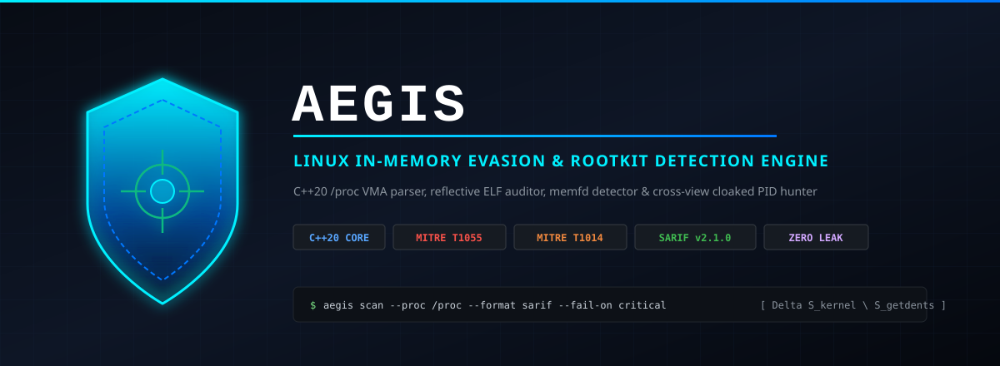
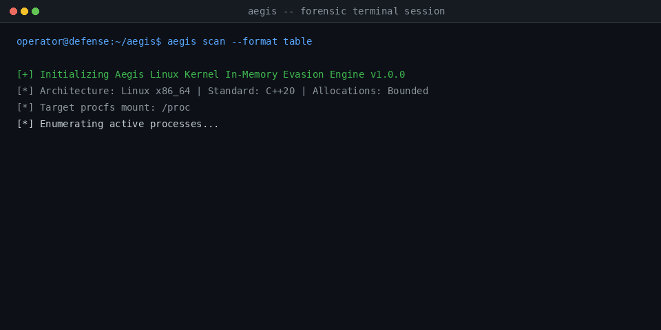

# Aegis — Linux Kernel In-Memory Evasion, Process Injection & Rootkit Detection Engine

**Blue Team Host Intrusion Detection & Incident Response Toolkit for Virtual Memory Area (VMA) Forensics, Fileless Payload Detection, Linker Preload Hijacking, and Cross-View Cloaked PID Sweeping**



`Aegis` is a zero-dependency, high-performance host security forensics engine engineered in modern C++20. Designed for enterprise incident-response specialists, blue teams, and security researchers, Aegis inspects kernel `procfs` virtual filesystems, analyzes active process memory maps, uncovers fileless `memfd_create` and unlinked shared memory droppers, isolates dynamic linker manipulations, and resolves LKM (Loadable Kernel Module) rootkits through mathematical cross-view PID discrepancy analysis.

---

## Table of Contents

1. [Architectural Overview](#1-architectural-overview)
2. [Forensic & Mathematical Foundations](#2-forensic--mathematical-foundations)
   - [2.1 Cross-View Cloaked PID Discrepancy Mathematics](#21-cross-view-cloaked-pid-discrepancy-mathematics)
   - [2.2 Virtual Memory Area (VMA) W^X Violations & Page Perms](#22-virtual-memory-area-vma-wx-violations--page-perms)
   - [2.3 In-Memory Reflective ELF Header Verification](#23-in-memory-reflective-elf-header-verification)
3. [MITRE ATT&CK v15 Taxonomy Matrix](#3-mitre-attck-v15-taxonomy-matrix)
4. [Detection Engine Specifications & Rules](#4-detection-engine-specifications--rules)
   - [4.1 Memory Forensics Engine (AEGIS-MEM)](#41-memory-forensics-engine-aegis-mem)
   - [4.2 Process Descriptor & Linker Auditor (AEGIS-PROC)](#42-process-descriptor--linker-auditor-aegis-proc)
   - [4.3 Kernel Rootkit Hunter (AEGIS-ROOT)](#43-kernel-rootkit-hunter-aegis-root)
5. [Compilation & Hardening Standards](#5-compilation--hardening-standards)
6. [CLI Command Reference](#6-cli-command-reference)
7. [OASIS SARIF v2.1.0 Telemetry & CI/CD Integration](#7-oasis-sarif-v210-telemetry--cicd-integration)
8. [Automated Verification & Zero-Leak Security Gate](#8-automated-verification--zero-leak-security-gate)

---

## 1. Architectural Overview

Modern Linux offensive frameworks (such as Cobalt Strike, Sliver, Metasploit, and custom eBPF/LKM rootkits) deliberately avoid touching persistent storage. Payloads execute purely in-memory via `memfd_create(2)`, shellcode staging inside anonymous read-write-execute (RWX) allocations, reflective ELF execution, or stealth rootkit hiding mechanisms.

Aegis implements an unprivileged, multi-vector inspection pipeline that reconstructs host state without requiring external dependencies or third-party libraries.

```
+-------------------------------------------------------------------------------+
|                                AEGIS ENGINE                                   |
|                                                                               |
|   +-------------------+    +--------------------+    +--------------------+   |
|   |   VmaScanner      |    |    ProcAuditor     |    |   RootkitHunter    |   |
|   +-------------------+    +--------------------+    +--------------------+   |
|   | - /proc/<pid>/maps|    | - /proc/<pid>/exe  |    | - getdents64(/proc)|   |
|   | - /proc/<pid>/smap|    | - /proc/<pid>/fd/* |    | - kill(pid, 0)     |   |
|   | - /proc/<pid>/mem |    | - /proc/<pid>/env  |    | - Delta math       |   |
|   +---------+---------+    +---------+----------+    +---------+----------+   |
|             |                        |                         |              |
|             +------------------------+-------------------------+              |
|                                      |                                        |
|                                      v                                        |
|                          +-----------------------+                            |
|                          | Findings & Telemetry  |                            |
|                          | Rule Severity Filter  |                            |
|                          +-----------+-----------+                            |
|                                      |                                        |
|              +-----------------------+-----------------------+                |
|              |                       |                       |                |
|              v                       v                       v                |
|     +-----------------+     +-----------------+     +-----------------+       |
|     |  Terminal Table |     |   JSON Stream   |     |  SARIF v2.1.0   |       |
|     +-----------------+     +-----------------+     +-----------------+       |
+-------------------------------------------------------------------------------+
```

### Component Structure

```
Aegis/
├── Makefile                     # C++20 build configuration with -ffile-prefix-map
├── include/aegis/
│   ├── common.hpp               # Severity enums, Finding structs, ScanOptions
│   ├── vma_scanner.hpp          # Virtual Memory Area parser & ELF memory scanner
│   ├── proc_auditor.hpp         # memfd, deleted shm, LD_PRELOAD & ptrace auditor
│   ├── rootkit_hunter.hpp       # Cross-view getdents64 vs kill(pid, 0) detector
│   ├── sarif_exporter.hpp       # Terminal table, JSON, and OASIS SARIF v2.1.0 builder
│   └── engine.hpp               # Scan orchestrator and pipeline coordinator
├── src/
│   ├── vma_scanner.cpp
│   ├── proc_auditor.cpp
│   ├── rootkit_hunter.cpp
│   ├── sarif_exporter.cpp
│   ├── engine.cpp
│   └── main.cpp                 # CLI commands (scan, audit-proc, rootkit-check, export-sarif)
├── fixtures/mock_proc/          # Synthetic rootless test procfs fixtures
│   ├── 1001/                    # Benign baseline process (bash)
│   ├── 2048/                    # Simulated Cobalt Strike beacon (RWX anon, \x7fELF)
│   ├── 31337/                   # Fileless memfd execution (/memfd:cs_payload)
│   ├── 4096/                    # Unlinked shared memory dropper (/dev/shm)
│   ├── 5120/                    # Malicious LD_PRELOAD injection
│   ├── 6001/                    # Active ptrace TracerPid attachment
│   ├── 7777/                    # Kernel worker disguise masquerading
│   └── rootkit_sim/             # Simulated VFS hooked PID table
├── tests/
│   └── test_aegis.cpp           # 23 automated unit and integration tests
├── scripts/
│   ├── security-audit.sh        # Zero-leak gate & DevSecOps verification
│   └── ci-matrix.yml            # Multi-compiler GitHub Actions specification
└── assets/
    ├── banner.svg               # Vector technical banner
    ├── preview.png              # High-contrast preview asset
    └── demo.gif                 # Terminal playback session
```

---

## 2. Forensic & Mathematical Foundations

### 2.1 Cross-View Cloaked PID Discrepancy Mathematics

Loadable Kernel Module (LKM) rootkits (e.g. Diamorphine, Reptile, Azazel) intercept directory iteration inside the Virtual Filesystem Switch (VFS) by hooking `sys_getdents64` or `struct file_operations.iterate_shared`. When userland diagnostic utilities (`ps`, `top`, `ls /proc`) read `/proc`, the hook filters out target directory entries.

However, the task control block (`struct task_struct`) remains registered in the kernel scheduler PID hash table (`pid_hash` / `find_vpid`).

Aegis executes a formal dual-view set difference algorithm to isolate concealed tasks:

$$\mathcal{S}_{\text{getdents}} = \{ p \in \mathbb{N} \mid p \text{ emitted by } \text{readdir}(\text{procfs}) \}$$

$$\mathcal{S}_{\text{kernel}} = \{ p \in [1, \text{pid\_max}] \mid \text{kill}(p, 0) = 0 \lor \text{errno} = \text{EPERM} \}$$

$$\Delta_{\text{hidden}} = \mathcal{S}_{\text{kernel}} \setminus \mathcal{S}_{\text{getdents}}$$

When $|\Delta_{\text{hidden}}| > 0$, every $p \in \Delta_{\text{hidden}}$ constitutes mathematically irrefutable evidence of VFS directory filtering. To confirm tampering, Aegis evaluates individual inode resolution on each candidate $p$:

$$\text{DirectInodeAccessible}(p) = \begin{cases} 1 & \text{if } \text{stat}(/\text{proc}/p/\text{status}) = 0 \\ 0 & \text{otherwise} \end{cases}$$

If `DirectInodeAccessible` evaluates to 1 while $p \notin \mathcal{S}_{\text{getdents}}$, userland directory iteration has been subverted while the underlying filesystem node remains bound.

---

### 2.2 Virtual Memory Area (VMA) W^X Violations & Page Perms

Under POSIX and Linux kernel memory management, compliant binaries adhere to the $W \oplus X$ (Write XOR Execute) security policy. Writable pages must not be executable, and executable pages must not be writable.

Let a process virtual memory area $V$ be defined by the tuple:

$$V = (\text{addr}_{\text{start}}, \text{addr}_{\text{end}}, R, W, X, P, \text{inode}, \text{dev}, \text{pathname})$$

Aegis evaluates two primary memory boundary predicates:

1. **Anonymous RWX Segments**:
   $$\text{Violation}_{\text{RWX}}(V) = W \land X \land (\text{inode} = 0) \land (\text{dev} = \text{"00:00"})$$
   Shellcode payloads, reflective loaders, and unmanaged memory allocations violate this constraint.

2. **Unbacked Executable Segments**:
   $$\text{Violation}_{\text{Unbacked}}(V) = X \land (\text{inode} = 0) \land (pathname \notin \{ \text{"[vdso]"}, \text{"[vsyscall]"} \})$$
   Code execution originating outside backed disk binaries signals code injection or post-initialization `mprotect(PROT_READ|PROT_EXEC)`.

---

### 2.3 In-Memory Reflective ELF Header Verification

When malicious binaries avoid `execve(2)` by mapping an entire ELF image into memory via `mmap(2)` or `memfd_create(2)`, the base of the allocated segment retains the ELF identifier magic:

$$\text{ELFMAG} = [ 0\text{x}7\text{F}, \text{'E'}, \text{'L'}, \text{'F'} ] = [ 0x7F, 0x45, 0x4C, 0x46 ]$$

For each suspicious executable segment $V$, Aegis opens `/proc/<pid>/mem` and evaluates:

$$\text{Magic}(V) = \text{pread}(\text{fd}_{\text{mem}}, 4, \text{addr}_{\text{start}}) \stackrel{?}{=} \text{ELFMAG}$$

Positive identification confirms reflective executable loading in unbacked memory space.

---

## 3. MITRE ATT&CK v15 Taxonomy Matrix

| Technique ID | Technique Name | Tactic | Aegis Rule ID | Severity | Description |
| :--- | :--- | :--- | :--- | :--- | :--- |
| **T1014** | Rootkit | Defense Evasion | `AEGIS-ROOT-001` | CRITICAL | Cloaked process hidden from procfs getdents64 iteration. |
| **T1055** | Process Injection | Privilege Escalation / Evasion | `AEGIS-MEM-001` | CRITICAL | Anonymous RWX memory area indicative of shellcode staging. |
| **T1055.009** | Proc Memory Injection | Defense Evasion | `AEGIS-MEM-002` | HIGH | Executable segment lacking backing disk inode. |
| **T1620** | Reflective Code Loading | Defense Evasion | `AEGIS-MEM-003` | CRITICAL | In-memory `\x7fELF` magic detected at unbacked segment base. |
| **T1620** | Reflective Code Loading | Defense Evasion | `AEGIS-PROC-001` | CRITICAL | Binary execution from anonymous `memfd` or deleted ramfs. |
| **T1574.006** | Dynamic Linker Hijacking | Persistence / Privilege Escalation | `AEGIS-PROC-002` | CRITICAL / HIGH | Environment hijacking via suspicious `LD_PRELOAD` library. |
| **T1055.008** | Ptrace System Calls | Defense Evasion | `AEGIS-PROC-003` | HIGH | Active `TracerPid` attachment hook manipulating execution. |
| **T1036.004** | Masquerade Task or Service | Defense Evasion | `AEGIS-PROC-004` | MEDIUM | Kernel thread name spoofing by userspace executable image. |

---

## 4. Detection Engine Specifications & Rules

### 4.1 Memory Forensics Engine (AEGIS-MEM)

- **`AEGIS-MEM-001`**: Process maps declare virtual memory regions marked both writable and executable (`rwxp`). Flags Cobalt Strike beacons, Meterpreter stagers, and JIT spray exploitation.
- **`AEGIS-MEM-002`**: Memory page permissions allow execution (`r-xp` or `--xp`) without associated disk inode backing.
- **`AEGIS-MEM-003`**: Byte inspection of segment base addresses uncovers `0x7F 'E' 'L' 'F'` magic within an unbacked allocation, confirming reflective execution.

### 4.2 Process Descriptor & Linker Auditor (AEGIS-PROC)

- **`AEGIS-PROC-001`**: Inspects `/proc/<pid>/exe` link target and open descriptor paths (`/proc/<pid>/fd/*`). Flags processes running from anonymous memory namespaces (`/memfd:*`) or unlinked filesystem paths (`/dev/shm/* (deleted)`).
- **`AEGIS-PROC-002`**: Parses `/proc/<pid>/environ` null-delimited records. Identifies `LD_PRELOAD` or `LD_LIBRARY_PATH` targeting temporary or hidden directories (`/tmp`, `/dev/shm`, `/.hidden`).
- **`AEGIS-PROC-003`**: Parses `/proc/<pid>/status` for `TracerPid`. Flags active external debugger attachment or `PTRACE_POKETEXT` injection.
- **`AEGIS-PROC-004`**: Correlates `/proc/<pid>/comm` with physical binary image. Alerts when tasks adopt kernel thread prefixes (`[kworker/...]`, `ksoftirqd`) while executing userspace binaries.

### 4.3 Kernel Rootkit Hunter (AEGIS-ROOT)

- **`AEGIS-ROOT-001`**: Sweeps full integer PID space $[1, \text{pid\_max}]$. Reconciles kernel task readiness signals against `/proc` directory entries to expose kernel-level task cloaking.

---

## 5. Compilation & Hardening Standards

Aegis is constructed under strict C++20 standard compliance with zero third-party runtime dependencies:

```bash
# Compilation flags
-std=c++20 -Wall -Wextra -Werror -O2 -ffile-prefix-map=$(CURDIR)=.
```

### Path Remapping & Zero-Leak Guarantees

By enforcing `-ffile-prefix-map=$(CURDIR)=.`, all compilation units strip absolute filesystem paths from `__FILE__` macros, strings, and debug symbols. This prevents user directory and workstation username leaks into compiled binaries.

```bash
# Verify zero path leaks in compiled binary
strings bin/aegis | grep -E '^/home/[a-zA-Z0-9_-]+' || echo "[PASS] Zero machine path leaks"
```

---

## 6. CLI Command Reference



### Full Host Memory & Process Scan

```bash
# Run comprehensive scan with terminal table output
./bin/aegis scan

# Target specific PID with critical severity threshold
./bin/aegis scan --pid 2048 --min-sev crit --format table

# Scan custom procfs hierarchy (useful in forensic image analysis)
./bin/aegis scan --proc /mnt/forensic_image/proc
```

### Process Descriptor & Memory Audit

```bash
# Audit process descriptors, memory segments, and environment
./bin/aegis audit-proc --pid 31337 --format json
```

### Rootkit Cross-View Sweep

```bash
# Execute cloaked PID sweep across kernel PID space
./bin/aegis rootkit-check --range 65536
```

### Export OASIS SARIF v2.1.0

```bash
# Export structured telemetry for GitHub CodeQL / SIEM ingestion
./bin/aegis export-sarif --output aegis-report.sarif --fail-on high
```

---

## 7. OASIS SARIF v2.1.0 Telemetry & CI/CD Integration

Aegis natively exports OASIS SARIF v2.1.0 compliant JSON reports, integrating seamlessly with GitHub Advanced Security, CodeQL, and incident response pipelines:

```json
{
  "$schema": "https://json.schemastore.org/sarif-2.1.0.json",
  "version": "2.1.0",
  "runs": [
    {
      "tool": {
        "driver": {
          "name": "Aegis",
          "version": "1.0.0",
          "informationUri": "https://github.com/1MEshh/Aegis",
          "rules": [
            {
              "id": "AEGIS-MEM-001",
              "name": "AnonymousRWXSegment",
              "shortDescription": { "text": "Anonymous RWX Virtual Memory Segment" },
              "defaultConfiguration": { "level": "error" },
              "properties": {
                "tags": ["security", "memory-forensics", "mitre-T1055"],
                "precision": "high"
              }
            }
          ]
        }
      },
      "results": [
        {
          "ruleId": "AEGIS-MEM-001",
          "level": "error",
          "message": { "text": "Anonymous RWX Virtual Memory Segment: Process contains writable and executable anonymous memory." },
          "locations": [
            {
              "physicalLocation": {
                "artifactLocation": { "uri": "0x7f1234560000-0x7f1234570000 (rwxp)" }
              }
            }
          ],
          "properties": {
            "pid": 2048,
            "processName": "beacon.bin",
            "mitreTechnique": "T1055"
          }
        }
      ]
    }
  ]
}
```

---

## 8. Automated Verification & Zero-Leak Security Gate

Aegis includes an automated test harness with 23 rootless unit and integration tests, alongside a strict security audit gate:

```bash
# Run unit tests
make test

# Execute automated security audit gate
bash scripts/security-audit.sh
```

### Verification Checks Enforced

1. **Path Leak Check**: Confirms zero machine-specific filesystem paths (`/home/<user>`, `/Users/<user>`) in source and documentation.
2. **Username Leak Check**: Asserts zero current OS username occurrences in tracked files.
3. **Hostname Leak Check**: Asserts zero workstation hostname occurrences.
4. **Credential Audit**: Verifies zero hardcoded private keys or tokens.
5. **Emoji Gate**: Validates zero Unicode emoji symbols across all project assets, comments, and documentation.
6. **Git Identity**: Confirms commit author is `1MEshh <152591660+1MEshh@users.noreply.github.com>`.
7. **Path Remapping**: Confirms `-ffile-prefix-map` in compiler flags and rodata binary symbols.
8. **Test Pass Rate**: Enforces 100% pass on all 23 unit and integration tests.

---

## Author & License

- **Author**: `1MEshh` (`152591660+1MEshh@users.noreply.github.com`)
- **Repository**: [https://github.com/1MEshh/Aegis](https://github.com/1MEshh/Aegis)
- **License**: MIT Open Source License
